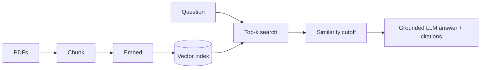

# End-to-End RAG Chatbot

Ask questions across 100+ PDFs and get grounded, cited answers. Built with **LlamaIndex**, with **OpenAI** or **AWS Bedrock** as a drop-in model provider (one env var).

 

## Highlights

| Metric | Result |
|---|---|
| Retrieval relevance vs. keyword search | **+31%** |
| Average response latency | **7.8s → 2.9s** |
| Hallucinated responses | **~45% fewer** |

> These figures come from my own 100+ PDF corpus and question set. Results depend on your documents, so reproduce them on yours with the scripts in [`evaluation/`](evaluation/) (see [Reproducing the results](#reproducing-the-results)).

## Features

- **Provider-agnostic**: switch between OpenAI and AWS Bedrock (Claude + Titan embeddings) with `RAG_PROVIDER`.
- **Incremental ingestion**: re-running `ragbot ingest` only re-embeds new or changed PDFs.
- **Grounded answers**: strict prompt, similarity cutoff with explicit refusal, temperature 0, inline `[file, p.N]` citations.
- **Fast**: persisted index, batched embeddings, compact synthesis, token streaming, LRU cache.
- **Three interfaces**: CLI chat, REST API (FastAPI), Docker image.
- **Measurable**: built-in evaluation for retrieval (Hit@k, MRR vs BM25), latency (mean/p50/p95) and hallucination rate (LLM-judge faithfulness).

## Architecture



Full diagram and design rationale: [docs/architecture.md](docs/architecture.md).

## Quickstart

```bash
git clone https://github.com/<you>/rag-chatbot.git && cd rag-chatbot
python -m venv .venv && source .venv/bin/activate
pip install -r requirements.txt

cp .env.example .env          # add your OPENAI_API_KEY (or set RAG_PROVIDER=bedrock)
cp /path/to/your/*.pdf data/pdfs/

ragbot ingest                  # build the index
ragbot chat                    # interactive streaming chat
ragbot ask "What is the refund policy?"
```

### Use AWS Bedrock instead of OpenAI

```bash
# .env
RAG_PROVIDER=bedrock
AWS_REGION=us-east-1
```
Configure AWS credentials the usual way (`aws configure`, env vars or an IAM role) and enable model access for your chosen models in the Bedrock console.

### REST API

```bash
ragbot serve   # http://localhost:8000/docs
curl -X POST localhost:8000/ask -H "content-type: application/json" \
     -d '{"question": "Summarize the termination clause"}'
```

### Docker

```bash
docker build -t ragbot .
docker run -p 8000:8000 --env-file .env \
  -v $(pwd)/data:/app/data -v $(pwd)/storage:/app/storage ragbot
```

## How it works

**Ingestion**: `SimpleDirectoryReader` loads PDFs (page-level, with `file_name` / `page_label` metadata) → `SentenceSplitter` (512 tokens, 64 overlap) → batched embeddings → persisted vector index.

**Querying**: top-k vector search → similarity cutoff → if nothing relevant, refuse; otherwise grounded prompt with compact synthesis → answer with citations.

### What drove the latency drop
Persisted index (no re-embedding on startup), smaller top-k plus a similarity cutoff (less context for the LLM), `compact` instead of iterative `refine` synthesis (fewer LLM calls), streaming, and an LRU cache for repeat questions.

### What reduced hallucinations
Context-only prompt with an explicit "not found" exit, refusing when retrieval is weak instead of letting the model guess, temperature 0, and mandatory citations.

## Reproducing the results

`baseline` mode in the engine intentionally mimics a naive pipeline (larger top-k, no cutoff, default prompt, `refine` synthesis, no cache), so before/after comparisons are honest and repeatable.

```bash
cp evaluation/dataset.example.jsonl evaluation/dataset.jsonl
# Edit it: one JSON object per line, ~50+ questions about YOUR PDFs:
# {"question": "...", "relevant_file": "exact_file_name.pdf"}
# Add some out-of-scope questions too, to test refusal behaviour.

python evaluation/eval_retrieval.py     # vector vs BM25 keyword: Hit@k, MRR
python evaluation/benchmark_latency.py  # baseline vs optimized: mean / p50 / p95
python evaluation/eval_hallucination.py # LLM-judge faithfulness, baseline vs optimized
```

Results are printed and saved as JSON in `evaluation/results/`.

## Configuration

All settings live in `.env` (see [.env.example](.env.example)):

| Variable | Default | Purpose |
|---|---|---|
| `RAG_PROVIDER` | `openai` | `openai` or `bedrock` |
| `RAG_CHUNK_SIZE` / `RAG_CHUNK_OVERLAP` | `512` / `64` | Chunking |
| `RAG_TOP_K` | `4` | Chunks sent to the LLM |
| `RAG_SIMILARITY_CUTOFF` | `0.30` | Below this, chunks are dropped (tune per embedding model) |
| `RAG_EMBED_BATCH_SIZE` | `64` | Embedding batch size |
| `RAG_CACHE_SIZE` | `256` | LRU answer cache entries |

## Project structure

```
src/ragbot/
  config.py   env-driven settings        llm.py      OpenAI / Bedrock factory
  ingest.py   load, chunk, embed, persist engine.py   retrieval + grounded answering
  cache.py    LRU cache                  cli.py / api.py   interfaces
evaluation/   retrieval, latency, hallucination scripts
tests/        unit tests (no API keys needed)
docs/         architecture
```

## Development

```bash
make test    # pytest
make lint    # ruff
```

CI runs lint + tests on Python 3.10-3.12 for every push and PR.

## Limitations and next steps

- Scanned (image-only) PDFs need OCR before ingestion.
- Local on-disk vector store is great up to thousands of chunks; swap in FAISS / pgvector / OpenSearch for larger corpora.
- Ideas: hybrid (BM25 + vector) retrieval, cross-encoder reranking, conversation memory, Streamlit UI.

## License

MIT
