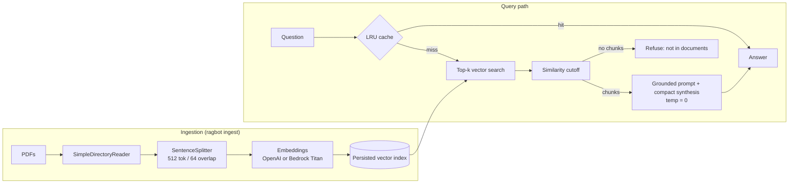

# Architecture

## Why each optimization exists

| Technique | Effect |
|---|---|
| Persisted index, loaded at startup | No re-embedding per run, so startup is seconds not minutes |
| Incremental ingest (`refresh_ref_docs`) | Only new or changed PDFs are re-embedded |
| Batched embeddings | Fewer API round-trips during indexing |
| Smaller top-k + similarity cutoff | Less context to read, so lower latency and cost; weak matches never reach the LLM |
| Compact synthesis | Packs chunks into as few LLM calls as possible instead of iterative refine |
| Response streaming | Time-to-first-token drives perceived latency |
| LRU cache | Repeated questions return in milliseconds |

## Why each guardrail exists (hallucination)

| Technique | Effect |
|---|---|
| Strict "context only" prompt | Model is told not to use outside knowledge |
| Explicit refusal string | Gives the model a safe exit instead of guessing |
| Similarity cutoff, then refuse | If retrieval is weak, the LLM is never asked |
| Temperature 0 | Deterministic, less creative drift |
| Inline `[file, p.N]` citations | Every claim is checkable |
